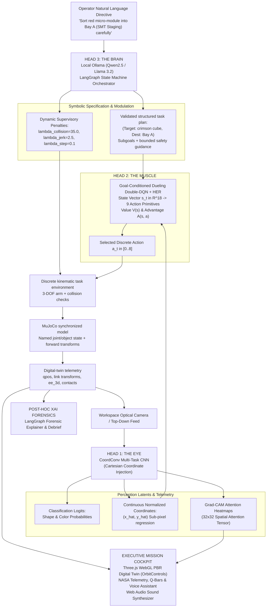

# 🐺 CERBERUS-ARM: Tri-Modal Autonomous Robotic Manipulation Platform

```
  ██████╗███████╗██████╗ ██████╗ ███████╗██████╗ ██╗   ██╗███████╗     █████╗ ██████╗ ███╗   ███╗
 ██╔════╝██╔════╝██╔══██╗██╔══██╗██╔════╝██╔══██╗██║   ██║██╔════╝    ██╔══██╗██╔══██╗████╗ ████║
 ██║     █████╗  ██████╔╝██████╔╝█████╗  ██████╔╝██║   ██║███████╗    ███████║██████╔╝██╔████╔██║
 ██║     ██╔══╝  ██╔══██╗██╔══██╗██╔══╝  ██╔══██╗██║   ██║╚════██║    ██╔══██║██╔══██╗██║╚██╔╝██║
 ╚██████╗███████╗██║  ██║██████╔╝███████╗██║  ██║╚██████╔╝███████║    ██║  ██║██║  ██║██║ ╚═╝ ██║
  ╚═════╝╚══════╝╚═╝  ╚═╝╚═════╝ ╚══════╝╚═╝  ╚═╝ ╚═════╝ ╚══════╝    ╚═╝  ╚═╝╚═╝  ╚═╝╚═╝     ╚═╝
```

<p align="center">
  <strong>The Three-Headed Robotic Intelligence.</strong><br>
  <em>Vision. Reasoning. Manipulation.</em>
</p>

<p align="center">
  <a href="#-quick-start"></a>
  <a href="#-system-architecture"></a>
  <a href="#-threejs-pbr-digital-twin"></a>
  <a href="#-quick-start"></a>
  <a href="#-api-reference"></a>
  <a href="#-local-ollama-reasoning"></a>
  <a href="#-local-ollama-reasoning"></a>
  <a href="LICENSE"></a>
</p>

<p align="center">
  A simulated 3-DOF robotic manipulation project for cleanroom-style component sorting. It combines CoordConv perception, local LangGraph + Ollama task planning, a DQfD-style Dueling Double-DQN with HER, and a MuJoCo-synchronized 3D digital twin.
</p>

---

## 🏛️ System Architecture

CERBERUS combines three software modules in a simulated manipulation pipeline:



---

## 🏭 Simulated Cleanroom-Style Sorting Workcell

The simulated scene represents a cleanroom-style component sorting task. It is not a validated physical workcell or deployment claim:

### 1. Dedicated Sorting Stations
- **Bay A · SMT Staging (`[-1.25, 0.45] m`, Crimson)**: Infeed assembly bay for surface-mount integrated circuits and passive hybrid packages.
- **Bay B · AOI Inspection (`[+1.25, 0.45] m`, Cobalt)**: High-speed automated optical inspection docking plate with concentric laser calibration rings.
- **Bay C · Cleanroom QA (`[0.00, 1.60] m`, Emerald)**: Pass-through chamber dock with air-shower ventilation perimeter for certified cleanroom packaging.

### 2. Central Hazard Obstacle
- **Laser Metrology Spindle (`[0.00, 0.85] m`, $R=0.20\text{ m}$)**: Heavy vertical optical inspection tower with an active vertical laser safety light curtain that the arm must circumnavigate without collision.

### 3. Dynamic Cleanroom Sample Space (Randomized on Reset)
On every scene reset, four components are sampled within the workspace:
- **Micro-Module IC Packages (Cubes)**: Matte graphite metallic bodies with gold alignment pin leads.
- **Quartz Focusing Lenses (Spheres)**: High-purity refractive crystal spheres with anti-reflective coating.
- **Dispersive Optical Prisms (Triangles)**: Polished optical crown glass triangular prisms for spectral beam steering.
- **Fiducial Sensor Stars**: Five-point sensor bodies with a central optic.

---

## 🔬 Core Innovations

### 1. 🦾 3-DOF Manipulator & MuJoCo-Synchronized Digital Twin (`MuJoCoStage3D`)
- **3-DOF Kinematic Chain**: Shoulder, elbow, and wrist joints use link lengths $L_1 = 0.90\text{ m}$, $L_2 = 0.70\text{ m}$, and $L_3 = 0.35\text{ m}$.
- **MuJoCo state**: The backend synchronizes named joint and object positions, calls MuJoCo forward kinematics, and returns link, end-effector, and contact telemetry. Discrete task actions are still applied by the planar environment; MuJoCo torque dynamics do not currently drive the controller.
- **Three.js WebGL Digital Twin**: Interactive browser rendering with detailed materials, lighting, shadows, joint callouts, and scene overlays.
- **OrbitControls Navigation**: Smooth click-to-orbit, right-click pan, and scroll-zoom with camera preset shortcuts (`Perspective 3D`, `Top-Down Plan`, `Side Elevation`).
- **Tactical Overlays**: Downward targeting laser beam, floor crosshair reticle, floating target bracket, contact spark halos, and glowing ghost trajectory ribbons.

### 2. 👁️ Head 1: The Eye (CoordConv Multi-Task CNN)
- **Coordinate Grounding (Liu et al., NeurIPS 2018)**: Concatenates explicit normalized Cartesian coordinate channels $[X, Y]$ to input frames, breaking convolutional translation invariance.
- **Simultaneous Multi-Task Inference**: Classifies shape and color and regresses normalized object coordinates. Measured synthetic validation metrics are documented in [TRAINING_RUN.md](docs/TRAINING_RUN.md).
- **Grad-CAM Attention Heatmaps**: Real-time gradient-weighted activation mapping exposes where the convolutional backbone focuses during perception.
- **Multi-Filter Vision HUD**: Interactive filter modes (RGB Video, Grad-CAM attention heatmap, synthetic depth, and tactical crosshair target lock).

### 3. ⚡ Head 2: The Muscle (Dueling Double-DQN + HER)
- **Dueling Decomposition**: Decouples state value $V(s)$ from the action advantage stream $A(s, a)$ to stabilize training across identical states.
- **Double-Q Evaluation**: Eliminates policy overestimation bias by separating action selection from target network evaluation.
- **Hindsight Experience Replay (HER, $k=4$)**: Stores valid future object positions as alternate goals for replay.
- **DQfD + action safety shield**: Expert-margin supervision trains from demonstrations; swept-collision and manipulability checks can mask unsafe actions.
- **9 Discrete Action Primitives**: Shoulder $\pm\Delta\theta$, Elbow $\pm\Delta\theta$, Wrist $\pm\Delta\theta$, Gripper Toggle, Micro-Align, and Hold.

### 4. 🧠 Head 3: The Brain (Local LangGraph Reasoner & XAI)
- **Local Ollama Inference**: When a local Ollama model is available, LangGraph uses it to propose a validated structured task plan; deterministic parsing is available as a fallback.
- **Structured task plan**: Grounds a requested object and destination and supplies bounded safety guidance; it does not execute PDDL.
- **Dynamic Supervisory Modulation**: Adjusts safety penalties dynamically (e.g. elevating $\lambda_{collision}$ and $\lambda_{jerk}$ when the user specifies caution).
- **Post-Hoc XAI Forensic Debriefs**: Grounded natural language explanations generated from telemetry logs explaining successes or collisions.

### 5. 🛰️ Mission Control Cockpit & Voice Assistant
- **"Hey Cerberus" Voice Assistant**: Interactive verbal command bar with pre-configured cleanroom prompts and real-time audio synthesis.
- **Epistemic Object Memory**: Real-time tracked component registry logging Cartesian coordinates, grasp statuses, timestamps, and confidence scores.
- **NASA Telemetry Gauges**: Real-time Q-value advantage bars, joint angles, manipulability $w(q)$, and physical jerk indices.
- **Web Audio API Synthesizer**: Custom robotic sound effects (servo steps, target lock chirps, gripper clamp thuds, and mission chimes).

---

## 📊 Held-out Policy Evaluation

Matched evaluation on 60 generated scenes (20 per task, seed 2027). The learned policy uses the action safety shield. It improves over random but remains behind the geometric reference; see [the full run log](docs/TRAINING_RUN.md) and per-episode data in `docs/training/results/`.

| Policy Architecture | Success Rate | Collision Rate | Mean Return | Mean Steps | Mean Jerk Index |
| :--- | :---: | :---: | :---: | :---: | :---: |
| **Random** | 0.0% | 81.7% | -42.49 | 55.0 | 3.328 |
| **Geometric reference** | 78.3% | 0.0% | +109.92 | 61.1 | 3.265 |
| **Trained DQfD + safety shield** | 28.3% | 0.0% | +68.46 | 101.3 | 3.116 |

---

## 📚 Technical Documentation

Explore deep dive technical specifications in [`docs/`](docs/):
- **[System Architecture](docs/ARCHITECTURE.md)**: Current module boundaries, telemetry, and safety checks.
- **[Kinematics & Differential Geometry](docs/KINEMATICS.md)**: 3-DOF forward/inverse kinematics, analytical $3\times 3$ Jacobian, and Yoshikawa manipulability $w(q)$.
- **[Perception & Grad-CAM](docs/PERCEPTION.md)**: CoordConv coordinate injection, multi-task losses, and Grad-CAM backpropagation.
- **[Reinforcement Learning Formulation](docs/REINFORCEMENT_LEARNING.md)**: 18-dim state space, 9 discrete action primitives, dueling network layers, Double-Q targets, and HER relabeling.
- **[MuJoCo 3D Digital Twin](docs/MUJOCO_PHYSICS.md)**: MJCF model, synchronized joint/object state, MuJoCo forward transforms, and Three.js rendering. The learned controller currently acts through discrete kinematic steps.
- **[Training run and evaluation](docs/TRAINING_RUN.md)**: Reproduction commands, CNN metrics, DQfD training telemetry, and held-out results.
- **[Frontend Architecture Guide](docs/FRONTEND.md)**: Design system, state synchronization, audio synthesis, and image generation.

---

## 🚀 Quick Start

### Prerequisites
- Python 3.11 or 3.12 (`uv` or `python3 -m venv`)
- Node.js $\ge 18$
- (Optional) Local [Ollama](https://ollama.ai/) running on port 11434 (`ollama run qwen2.5:3b-instruct` or `ollama run llama3.2`)

### 1. Installation
```bash
# Clone the repository
git clone https://github.com/darayavahoush/CERBERUS-ARM.git
cd CERBERUS-ARM

# Create Python virtual environment and install dependencies
uv venv --python 3.12 .venv
source .venv/bin/activate
uv pip install -r requirements.txt

# Install frontend dependencies and build production assets
cd frontend
npm install
npm run build
cd ..
```

### 2. Launch the Platform
```bash
# Start FastAPI backend (serves both API and the React frontend on port 8000)
PYTHONPATH=. .venv/bin/uvicorn backend.app:app --host 0.0.0.0 --port 8000
```
Open **[http://localhost:8000](http://localhost:8000)** in your browser!

### 3. Model Training & Offline Evaluation
```bash
# Train the Multi-Task Perception CNN
PYTHONPATH=. .venv/bin/python scripts/train_cnn.py

# Train the 3-DOF Dueling Double-DQN + HER Agent
PYTHONPATH=. .venv/bin/python scripts/train_d3qn.py
```

---

## 🛠️ API Reference

| Method | Endpoint | Description |
| :--- | :--- | :--- |
| `GET` | `/api/status` | Returns system health, device (MPS/CUDA), model status, and hyperparameters. |
| `GET` | `/api/mujoco/state` | Returns real-time 3D MuJoCo multi-body state, joint torques, and contact points. |
| `POST` | `/api/task/plan` | Compiles a natural-language command into a validated structured plan via local Ollama or deterministic fallback. |
| `POST` | `/api/env/reset` | Resets 3-DOF arm to home position and spawns randomized cleanroom sample space. |
| `POST` | `/api/env/step` | Advances simulation by 1 timestep using D3QN policy or manual joint primitive. |
| `POST` | `/api/perception/inspect` | Runs CoordConv CNN feature extraction and returns Grad-CAM attention heatmap. |
| `POST` | `/api/explain` | Generates grounded post-episode XAI forensic debrief. |
| `GET` | `/api/benchmark` | Runs comparative evaluation across Random, Vanilla D3QN, and Guided D3QN+HER. |
| `GET` | `/api/episodes` | Retrieves persisted episode history log. |
| `POST` | `/api/episodes` | Records finished episode outcome and physical jerk index. |
| `GET` | `/api/train/history` | Retrieves training run batches and loss trajectories. |
| `WS` | `/ws/simulate` | Bi-directional WebSocket stream for 60 FPS live simulation. |

---

## 📜 License
MIT License. Open source under the terms of the MIT license.
