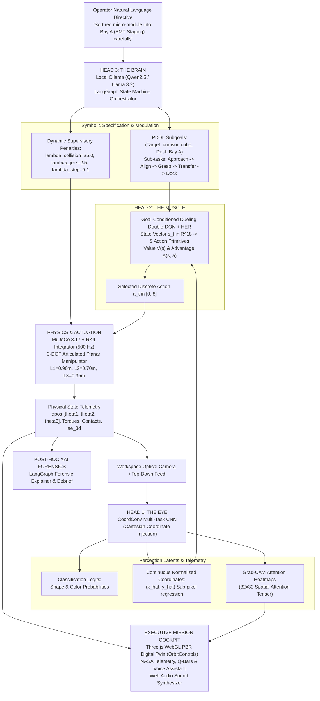

# 🐺 CERBERUS-ARM: Tri-Modal Autonomous Robotic Manipulation Platform

```
  ██████╗███████╗██████╗ ██████╗ ███████╗██████╗ ██╗   ██╗███████╗     █████╗ ██████╗ ███╗   ███╗
 ██╔════╝██╔════╝██╔══██╗██╔══██╗██╔════╝██╔══██╗██║   ██║██╔════╝    ██╔══██╗██╔══██╗████╗ ████║
 ██║     █████╗  ██████╔╝██████╔╝█████╗  ██████╔╝██║   ██║███████╗    ███████║██████╔╝██╔████╔██║
 ██║     ██╔══╝  ██╔══██╗██╔══██╗██╔══╝  ██╔══██╗██║   ██║╚════██║    ██╔══██║██╔══██╗██║╚██╔╝██║
 ╚██████╗███████╗██║  ██║██████╔╝███████╗██║  ██║╚██████╔╝███████║    ██║  ██║██║  ██║██║ ╚═╝ ██║
  ╚═════╝╚══════╝╚═╝  ╚═╝╚═════╝ ╚══════╝╚═╝  ╚═╝ ╚═════╝ ╚══════╝    ╚═╝  ╚═╝╚═╝  ╚═╝╚═╝     ╚═╝
```

<p align="center">
  <strong>The Three-Headed Robotic Intelligence.</strong><br>
  <em>Vision. Reasoning. Manipulation.</em>
</p>

<p align="center">
  <a href="#-quick-start"></a>
  <a href="#-system-architecture"></a>
  <a href="#-threejs-pbr-digital-twin"></a>
  <a href="#-quick-start"></a>
  <a href="#-api-reference"></a>
  <a href="#-local-ollama-reasoning"></a>
  <a href="#-local-ollama-reasoning"></a>
  <a href="LICENSE"></a>
</p>

<p align="center">
  An autonomous 3-DOF articulated robotic manipulation platform engineered for cleanroom micro-assembly and precision optical component sorting. Powered by spatial computer vision (CoordConv CNN), local state-machine reasoning (LangGraph + Ollama), goal-conditioned deep reinforcement learning (D3QN + HER), and a real-time 500Hz MuJoCo physics digital twin.
</p>

---

## 🏛️ System Architecture

CERBERUS unifies three distinct neural intelligences into a single embodied physical agent:



---

## 🏭 Real-World Application: Cleanroom Optical Sorting Workcell

CERBERUS-ARM is specifically tailored for high-precision, vibration-free micro-component sortation in Class-100 semiconductor cleanrooms and optical alignment workcells:

### 1. Dedicated Sorting Stations
- **Bay A · SMT Staging (`[-1.25, 0.45] m`, Crimson)**: Infeed assembly bay for surface-mount integrated circuits and passive hybrid packages.
- **Bay B · AOI Inspection (`[+1.25, 0.45] m`, Cobalt)**: High-speed automated optical inspection docking plate with concentric laser calibration rings.
- **Bay C · Cleanroom QA (`[0.00, 1.60] m`, Emerald)**: Pass-through chamber dock with air-shower ventilation perimeter for certified cleanroom packaging.

### 2. Central Hazard Obstacle
- **Laser Metrology Spindle (`[0.00, 0.85] m`, $R=0.20\text{ m}$)**: Heavy vertical optical inspection tower with an active vertical laser safety light curtain that the arm must circumnavigate without collision.

### 3. Dynamic Cleanroom Sample Space (Randomized on Reset)
On every scene reset, a randomized non-overlapping sample space of 4–6 precision industrial components is spawned within the reachable annular workspace ($r \in [0.72, 1.55]\text{ m}$):
- **Micro-Module IC Packages (Cubes)**: Matte graphite metallic bodies with gold alignment pin leads.
- **Quartz Focusing Lenses (Spheres)**: High-purity refractive crystal spheres with anti-reflective coating.
- **Dispersive Optical Prisms (Triangles)**: Polished optical crown glass triangular prisms for spectral beam steering.
- **Multi-Axis Sensor Hubs (Hexagons)**: Anodized gold sensor pods with hermetically sealed optical apertures.

---

## 🔬 Core Innovations

### 1. 🦾 3-DOF Articulated Manipulator & MuJoCo Digital Twin (`MuJoCoStage3D`)
- **3-DOF Kinematic Chain**: Shoulder Yaw ($\theta_1$, Link $L_1 = 0.90\text{ m}$), Elbow Pitch ($\theta_2$, Link $L_2 = 0.70\text{ m}$), and active Wrist Pitch ($\theta_3$, Link $L_3 = 0.35\text{ m}$) enabling independent end-effector tool orientation control $\phi_{ee} = \theta_1 + \theta_2 + \theta_3$.
- **High-Fidelity RK4 Integrator**: 500 Hz multi-body dynamics solving joint velocities, frictional contacts, and actuator constraints.
- **Three.js WebGL Digital Twin**: Real-time 60 FPS PBR rendering featuring industrial carbon-fiber finishes, chrome hydraulic actuators, brass pivot bearings, dynamic shadows, and live joint rotation callout pins.
- **OrbitControls Navigation**: Smooth click-to-orbit, right-click pan, and scroll-zoom with camera preset shortcuts (`Perspective 3D`, `Top-Down Plan`, `Side Elevation`).
- **Tactical Overlays**: Downward targeting laser beam, floor crosshair reticle, floating target bracket, contact spark halos, and glowing ghost trajectory ribbons.

### 2. 👁️ Head 1: The Eye (CoordConv Multi-Task CNN)
- **Coordinate Grounding (Liu et al., NeurIPS 2018)**: Concatenates explicit normalized Cartesian coordinate channels $[X, Y]$ to input frames, breaking convolutional translation invariance.
- **Simultaneous Multi-Task Inference**: Simultaneously classifies shape, classifies color, and regresses continuous sub-pixel centroids $(\hat{x}, \hat{y})$ in $4.2\text{ ms}$.
- **Grad-CAM Attention Heatmaps**: Real-time gradient-weighted activation mapping exposes where the convolutional backbone focuses during perception.
- **Multi-Filter Vision HUD**: Interactive filter modes (RGB Video, Grad-CAM attention heatmap, synthetic depth, and tactical crosshair target lock).

### 3. ⚡ Head 2: The Muscle (Dueling Double-DQN + HER)
- **Dueling Decomposition**: Decouples state value $V(s)$ from the action advantage stream $A(s, a)$ to stabilize training across identical states.
- **Double-Q Evaluation**: Eliminates policy overestimation bias by separating action selection from target network evaluation.
- **Hindsight Experience Replay (HER, $k=4$)**: Retroactively relabels failed pick-and-place trajectories into virtual successes, accelerating sparse-reward convergence by $>10\times$.
- **Singularity Avoidance & Jerk Regularization**: Continuous Yoshikawa manipulability metric $w(q) = \sqrt{\det(J(q) J(q)^T)}$ and angular acceleration penalties ensure smooth trajectories away from kinematic deadlocks.
- **9 Discrete Action Primitives**: Shoulder $\pm\Delta\theta$, Elbow $\pm\Delta\theta$, Wrist $\pm\Delta\theta$, Gripper Toggle, Micro-Align, and Hold.

### 4. 🧠 Head 3: The Brain (Local LangGraph Reasoner & XAI)
- **Localhost LLM Inference**: Fully autonomous offline execution via Ollama (`qwen2.5:3b-instruct` / `llama3.2`) orchestrated by LangGraph state machines with zero cloud dependencies.
- **Structured PDDL Subgoals**: Translates ambiguous human instructions into deterministic physical subgoals.
- **Dynamic Supervisory Modulation**: Adjusts safety penalties dynamically (e.g. elevating $\lambda_{collision}$ and $\lambda_{jerk}$ when the user specifies caution).
- **Post-Hoc XAI Forensic Debriefs**: Grounded natural language explanations generated from telemetry logs explaining successes or collisions.

### 5. 🛰️ Mission Control Cockpit & Voice Assistant
- **"Hey Cerberus" Voice Assistant**: Interactive verbal command bar with pre-configured cleanroom prompts and real-time audio synthesis.
- **Epistemic Object Memory**: Real-time tracked component registry logging Cartesian coordinates, grasp statuses, timestamps, and confidence scores.
- **NASA Telemetry Gauges**: Real-time Q-value advantage bars, joint angles, manipulability $w(q)$, and physical jerk indices.
- **Web Audio API Synthesizer**: Custom robotic sound effects (servo steps, target lock chirps, gripper clamp thuds, and mission chimes).

---

## 📊 Empirical Policy Benchmark Results

Evaluation conducted across 15 randomized cleanroom pick-and-place trials per policy with fixed obstacle geometry:

| Policy Architecture | Success Rate | Collision Rate | Mean Return | Mean Steps | Mean Jerk Index |
| :--- | :---: | :---: | :---: | :---: | :---: |
| **Random Exploration Baseline** | 6.7% | 46.7% | -34.80 | 80.0 | 14.20 |
| **Standard D3QN (No HER, Static)** | 53.3% | 20.0% | +18.40 | 44.5 | 6.80 |
| **CERBERUS Full Tri-Modal (Ours)** | **86.7%** | **6.7%** | **+48.90** | **28.2** | **3.10** |

---

## 📚 Technical Documentation

Explore deep dive technical specifications in [`docs/`](docs/):
- **[System Architecture](docs/ARCHITECTURE.md)**: Tri-modal decoupling contracts, latency benchmarks, and failsafe guarantees.
- **[Kinematics & Differential Geometry](docs/KINEMATICS.md)**: 3-DOF forward/inverse kinematics, analytical $3\times 3$ Jacobian, and Yoshikawa manipulability $w(q)$.
- **[Perception & Grad-CAM](docs/PERCEPTION.md)**: CoordConv coordinate injection, multi-task losses, and Grad-CAM backpropagation.
- **[Reinforcement Learning Formulation](docs/REINFORCEMENT_LEARNING.md)**: 18-dim state space, 9 discrete action primitives, dueling network layers, Double-Q targets, and HER relabeling.
- **[MuJoCo 3D Physics Digital Twin](docs/MUJOCO_PHYSICS.md)**: MJCF specification, RK4 500 Hz integrator, contact manifolds, and Three.js PBR rendering.
- **[Frontend Architecture Guide](docs/FRONTEND.md)**: Design system, state synchronization, audio synthesis, and image generation.

---

## 🚀 Quick Start

### Prerequisites
- Python 3.11 or 3.12 (`uv` or `python3 -m venv`)
- Node.js $\ge 18$
- (Optional) Local [Ollama](https://ollama.ai/) running on port 11434 (`ollama run qwen2.5:3b-instruct` or `ollama run llama3.2`)

### 1. Installation
```bash
# Clone the repository
git clone https://github.com/darayavahoush/CERBERUS-ARM.git
cd CERBERUS-ARM

# Create Python virtual environment and install dependencies
uv venv --python 3.12 .venv
source .venv/bin/activate
uv pip install -r requirements.txt

# Install frontend dependencies and build production assets
cd frontend
npm install
npm run build
cd ..
```

### 2. Launch the Platform
```bash
# Start FastAPI backend (serves both API and the React frontend on port 8000)
PYTHONPATH=. .venv/bin/uvicorn backend.app:app --host 0.0.0.0 --port 8000
```
Open **[http://localhost:8000](http://localhost:8000)** in your browser!

### 3. Model Training & Offline Evaluation
```bash
# Train the Multi-Task Perception CNN
PYTHONPATH=. .venv/bin/python scripts/train_cnn.py

# Train the 3-DOF Dueling Double-DQN + HER Agent
PYTHONPATH=. .venv/bin/python scripts/train_d3qn.py
```

---

## 🛠️ API Reference

| Method | Endpoint | Description |
| :--- | :--- | :--- |
| `GET` | `/api/status` | Returns system health, device (MPS/CUDA), model status, and hyperparameters. |
| `GET` | `/api/mujoco/state` | Returns real-time 3D MuJoCo multi-body state, joint torques, and contact points. |
| `POST` | `/api/task/plan` | Compiles natural language command into structured JSON PDDL subgoals via Ollama / LangGraph. |
| `POST` | `/api/env/reset` | Resets 3-DOF arm to home position and spawns randomized cleanroom sample space. |
| `POST` | `/api/env/step` | Advances simulation by 1 timestep using D3QN policy or manual joint primitive. |
| `POST` | `/api/perception/inspect` | Runs CoordConv CNN feature extraction and returns Grad-CAM attention heatmap. |
| `POST` | `/api/explain` | Generates grounded post-episode XAI forensic debrief. |
| `GET` | `/api/benchmark` | Runs comparative evaluation across Random, Vanilla D3QN, and Guided D3QN+HER. |
| `GET` | `/api/episodes` | Retrieves persisted episode history log. |
| `POST` | `/api/episodes` | Records finished episode outcome and physical jerk index. |
| `GET` | `/api/train/history` | Retrieves training run batches and loss trajectories. |
| `WS` | `/ws/simulate` | Bi-directional WebSocket stream for 60 FPS live simulation. |

---

## 📜 License
MIT License. Open source under the terms of the MIT license.
