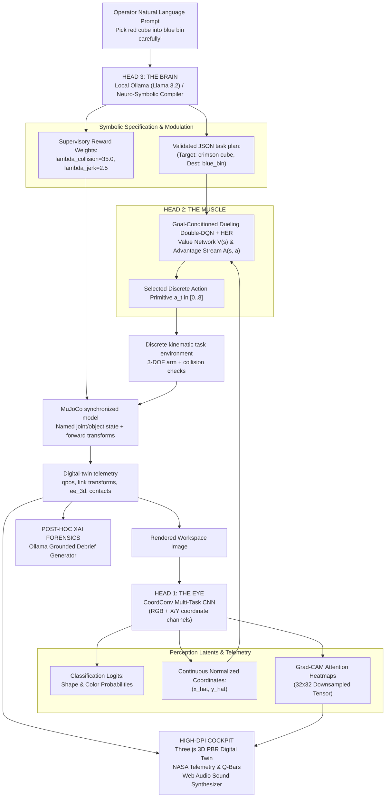

# CERBERUS-ARM: System Architecture & Control Flow

CERBERUS-ARM is a simulated three-module manipulation pipeline: perception, goal-conditioned control, and language-guided task planning. Each module exposes inspectable inputs and outputs so perception estimates, proposed plans, policy actions, and episode outcomes can be reviewed.

The local language model proposes a structured plan that is validated and grounded to objects and destinations in the active scene. The DRL policy selects discrete actions; a safety context can mask selected moves. The planar task environment applies actions and computes task rewards/collisions. MuJoCo receives synchronized joint/object state and returns forward-kinematic and contact telemetry for the Three.js digital twin; MuJoCo torque dynamics do not currently control the policy.

---

## 🏛️ High-Level System Topology

---

## 🐺 The Three Heads

### Head 1: The Eye (Spatial Perception)
- **Role**: Extracts semantic identity (shape and color) and continuous Cartesian centroids $(\hat{x}, \hat{y})$ from RGB workspace captures.
- **Backbone**: CoordConv architecture (Liu et al., NeurIPS 2018) that injects explicit spatial grid coordinates $(i, j)$ into feature maps, resolving convolutional translation invariance.
- **Interpretability**: Real-time gradient-weighted class activation mapping (Grad-CAM) exposes the convolutional filters' visual attention directly in the HUD.
- **Detailed Reference**: See [docs/PERCEPTION.md](file:///Users/ananyasridhar/Desktop/projects/avi-ana/docs/PERCEPTION.md).

### Head 2: The Muscle (Closed-Loop Manipulation)
- **Role**: Maps continuous state vectors $s_t \in \mathbb{R}^{18}$ to optimal discrete joint actuation primitives $a_t \in \mathcal{A}$ (9 primitives).
- **Algorithm**: Dueling Double-DQN (D3QN) with Hindsight Experience Replay (HER).
- **Kinematic Constraints**: 3-DOF articulated kinematics ($L_1 = 0.90\text{ m}, L_2 = 0.70\text{ m}, L_3 = 0.35\text{ m}$), Yoshikawa manipulability $w(q) = \sqrt{\det(J(q) J(q)^T)}$ singularity avoidance, and angular jerk regularization.
- **Detailed Reference**: See [docs/REINFORCEMENT_LEARNING.md](file:///Users/ananyasridhar/Desktop/projects/avi-ana/docs/REINFORCEMENT_LEARNING.md) and [docs/KINEMATICS.md](file:///Users/ananyasridhar/Desktop/projects/avi-ana/docs/KINEMATICS.md).

### Head 3: The Brain (Symbolic Reasoning & Forensic XAI)
- **Role**: Converts high-level instructions into a validated target/destination plan and bounded safety guidance; can produce a post-episode telemetry explanation.
- **Runtime**: Localhost Ollama inference (e.g. `llama3.2`, `mistral`, `deepseek-r1`) with a deterministic neuro-symbolic grammar fallback.
- **Safety boundary**: The plan validator checks the proposed target and destination against the scene and allowed schema. This reduces invalid-plan risk; it does not guarantee task success or zero collision.

---

## ⚡ Latency & Telemetry Pipeline

| Subsystem | Frequency | Target Latency | Compute Platform |
| :--- | :--- | :--- | :--- |
| **MuJoCo state synchronization** | On reset / action | Not benchmarked | MuJoCo Python binding |
| **D3QN action selector** | On demand | Not benchmarked | PyTorch (MPS / CUDA / CPU) |
| **CoordConv CNN** | On demand | Not benchmarked | PyTorch |
| **Grad-CAM extraction** | On inspection | Not benchmarked | PyTorch Autograd |
| **Three.js digital twin** | Browser render loop | Device dependent | WebGL (client GPU) |
| **Ollama planner** | On task request | Model / device dependent | Local Ollama or deterministic fallback |

---

## 🛡️ Failsafe & Zero-Collision Architecture

1. **Joint boundary clamping**: The task environment clamps candidate joint angles to its configured joint ranges.
2. **Swept hazard checks**: The task environment samples intermediate arm poses when checking actions against the central obstacle; the policy action context can mask moves that violate the configured clearance.
3. **Language-conditioned guidance**: Validated language plans can tune bounded supervisory weights and action-shield constraints. These checks reduce risk but do not guarantee collision-free task completion; see [held-out results](TRAINING_RUN.md).
