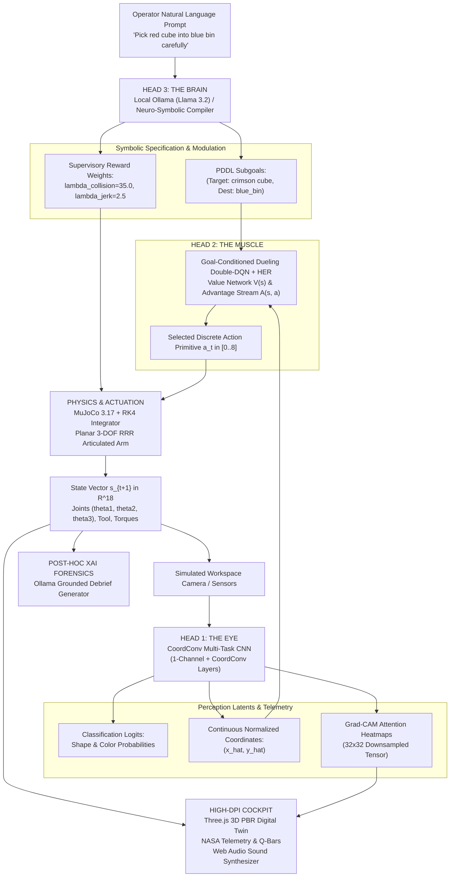

# CERBERUS-ARM: System Architecture & Tri-Modal Decoupling

CERBERUS-ARM is structured around a three-tier decoupled autonomy paradigm inspired by the legendary three-headed guardian. Traditional embodied AI systems often suffer from catastrophic entanglement: when vision fails, the controller crashes; when language hallucinates, actuators execute hazardous ungrounded trajectories. 

CERBERUS resolves this vulnerability by establishing strict formal contracts between **Perception (The Eye)**, **Control (The Muscle)**, and **Reasoning (The Brain)**, connected via an asynchronous telemetry bus and coordinated through a real-time **MuJoCo 3D physics digital twin**.

---

## 🏛️ High-Level System Topology

---

## 🐺 The Three Heads

### Head 1: The Eye (Spatial Perception)
- **Role**: Extracts semantic identity (shape and color) and continuous Cartesian centroids $(\hat{x}, \hat{y})$ from RGB workspace captures.
- **Backbone**: CoordConv architecture (Liu et al., NeurIPS 2018) that injects explicit spatial grid coordinates $(i, j)$ into feature maps, resolving convolutional translation invariance.
- **Interpretability**: Real-time gradient-weighted class activation mapping (Grad-CAM) exposes the convolutional filters' visual attention directly in the HUD.
- **Detailed Reference**: See [docs/PERCEPTION.md](file:///Users/ananyasridhar/Desktop/projects/avi-ana/docs/PERCEPTION.md).

### Head 2: The Muscle (Closed-Loop Manipulation)
- **Role**: Maps continuous state vectors $s_t \in \mathbb{R}^{18}$ to optimal discrete joint actuation primitives $a_t \in \mathcal{A}$ (9 primitives).
- **Algorithm**: Dueling Double-DQN (D3QN) with Hindsight Experience Replay (HER).
- **Kinematic Constraints**: 3-DOF articulated kinematics ($L_1 = 0.90\text{ m}, L_2 = 0.70\text{ m}, L_3 = 0.35\text{ m}$), Yoshikawa manipulability $w(q) = \sqrt{\det(J(q) J(q)^T)}$ singularity avoidance, and angular jerk regularization.
- **Detailed Reference**: See [docs/REINFORCEMENT_LEARNING.md](file:///Users/ananyasridhar/Desktop/projects/avi-ana/docs/REINFORCEMENT_LEARNING.md) and [docs/KINEMATICS.md](file:///Users/ananyasridhar/Desktop/projects/avi-ana/docs/KINEMATICS.md).

### Head 3: The Brain (Symbolic Reasoning & Forensic XAI)
- **Role**: Converts high-level human intent into structured PDDL-style subgoals and dynamic supervisory weights; performs post-episode forensic debriefs.
- **Runtime**: Localhost Ollama inference (e.g. `llama3.2`, `mistral`, `deepseek-r1`) with a deterministic neuro-symbolic grammar fallback.
- **Key Guarantee**: Complete isolation between reasoning and real-time joint actuation. If the LLM generates an invalid goal or hallucinates a non-existent object, the neuro-symbolic validator intercepts the directive before the physical arm is actuated.

---

## ⚡ Latency & Telemetry Pipeline

| Subsystem | Frequency | Target Latency | Compute Platform |
| :--- | :--- | :--- | :--- |
| **MuJoCo RK4 Integrator** | 500 Hz | $< 0.5 \text{ ms}$ | CPU / C-extension |
| **D3QN Action Selector** | 60 Hz | $< 4.0 \text{ ms}$ | PyTorch (MPS / CUDA / CPU) |
| **CoordConv Multi-Task CNN** | 20 Hz (on-demand) | $< 18.0 \text{ ms}$ | PyTorch |
| **Grad-CAM Extraction** | 10 Hz (on inspect) | $< 25.0 \text{ ms}$ | PyTorch Autograd |
| **Three.js Digital Twin** | 60 FPS | $16.6 \text{ ms / frame}$ | WebGL 2.0 (Client GPU) |
| **Ollama PDDL Compiler** | Asynchronous | $400 - 1200 \text{ ms}$ | Localhost Ollama |
| **Ollama XAI Debrief** | Post-Episode | $800 - 1500 \text{ ms}$ | Localhost Ollama |

---

## 🛡️ Failsafe & Zero-Collision Architecture

1. **Analytical Boundary Clamping**: Joint angles are bounded by mechanical limits $\theta_1 \in [-45^\circ, 210^\circ]$, $\theta_2 \in [5^\circ, 165^\circ]$ before being passed to MuJoCo.
2. **Hazard Envelope Detection**: Line-segment circle collision tests continuously check link 1, link 2, and the end-effector against the central hazard pillar.
3. **Dynamic Supervisory Modulation**: When operator language includes tokens like `"carefully"`, `"hazard"`, or `"fragile"`, Head 3 scales $\lambda_{collision}$ from $25.0 \to 50.0$ and $\lambda_{jerk}$ from $1.5 \to 3.5$, biasing the DRL Q-network toward safe paths.
